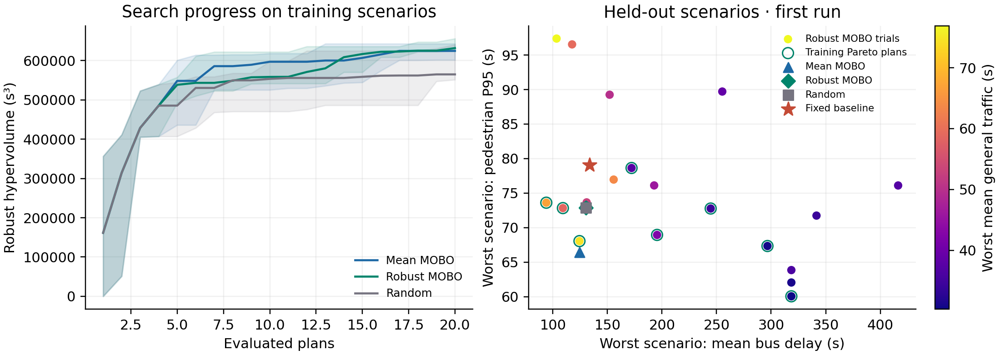

# Gongguan Signal BO｜公館路口號誌最佳化

公館圓環改造後的課堂原型。用 BoTorch 的 qLogNEHVI 搜尋兩個時制參數，展示縮短公車延誤和行人等待時的取捨，並比較平均情境與最壞情境兩種目標。

**Proposal:** [English PDF](report/Gongguan_BO_Proposal_EN.pdf) · [LaTeX source](report/Gongguan_BO_Proposal_EN.tex) · [原版中文 PDF](report/Gongguan_BO_Proposal.pdf)

## Why this intersection?

On my trips through Gongguan, my bus sometimes had to wait through several red lights before turning left onto Keelung Road. When I crossed on foot, the wait felt acceptable. The proposal asks whether peak-period signal timing can cut bus delays while keeping pedestrian waits acceptable. The simulator treats the bus delay as an aggregate proxy and does not model the specific left-turn movement.

The prototype uses BoTorch's **qLogNEHVI** to search signal cycle length and main-axis green share. It compares optimizing the average across three synthetic demand scenarios with optimizing each objective's worst scenario. It also tracks general-traffic delay to see who bears the cost of a timing change.



| Method | Mean bus delay (s) | Pedestrian P95 wait (s) | Mean general-traffic delay (s) |
| --- | ---: | ---: | ---: |
| Fixed synthetic plan | 133.7 | 79.1 | 38.5 |
| Average-scenario MOBO | 124.4 | 66.5 | 48.7 |
| Worst-scenario MOBO | 112.7 | 70.4 | 72.5 |
| Random search | 99.8 | 73.4 | 60.9 |

Each cell reports the median across four runs of the metric's worst held-out scenario. Compared with the fixed synthetic plan, worst-scenario MOBO reduced bus and pedestrian delays but increased general-traffic delay. Random search gave the shortest bus delays among the selected plans and a higher pedestrian wait than worst-scenario MOBO. These are simulated results with synthetic demand.

## 重跑

建議使用 Python 3.11。所有到達資料均由程式生成。

```sh
python3.11 -m venv .venv
source .venv/bin/activate
python -m pip install -r requirements.txt
python experiment.py
```

使用 `python experiment.py --budget 8 --runs 1 --output /tmp/gongguan-demo` 快速展示。完整實驗每個方法有 4 次搜尋，每次搜尋有 20 組候選方案。所有方法共用每次搜尋的前 4 組 Sobol 點與訓練需求。

## 一分鐘示範

先執行 `python simulator.py --cycle 130 --share 0.55` 查看固定基準，再換一組時制，例如 `python simulator.py --cycle 105 --share 0.62`，觀察各情境的等待變化。最後開啟 `results/results.png`，展示演算法如何用相同的預算找出一排取捨方案，以及推薦方案在保留情境中的表現。

## 讀取產出

- `results/trials.csv` 逐次記錄方案、各訓練情境指標與截至當次的穩健超體積。
- `results/holdout.csv` 各方法只靠訓練資料選出方案後，在保留情境上的結果。
- `results/results.png` 左圖呈現訓練穩健超體積，線為四次搜尋的中位數，陰影為最小至最大值。右圖只展示第 1 次搜尋，所有點以保留情境計分，空心圈標記在訓練情境上屬於 Pareto 前緣的候選。
- `report/Gongguan_BO_Proposal_EN.pdf` 為兩頁英文提案。可在 `report/` 執行 `tectonic Gongguan_BO_Proposal_EN.tex` 重編。原版中文提案保留在 `report/Gongguan_BO_Proposal.pdf`。

## 模擬與實驗設計

- 模擬羅斯福路／基隆路概念化的單一十字路口。可調週期 100–160 秒與主幹道可分配綠燈比例 45–65%。每相位先保留 25 秒綠燈與 5 秒清道，行人可在橫向綠燈開始後進入，最後 12 秒保留清空。
- 模擬一小時的隨機到達。車流以固定服務間隔 FIFO 排隊，公車使用獨立佇列。模擬繼續服務一小時內到達的車，避免忽略仍在排隊的車。行人模型量等待開始穿越的時間。
- 三種訓練情境為一般尖峰、公車成團到達、橫向交通尖峰。每個情境使用四個共用亂數樣本。保留評估提高各情境的到達率，並更換為十二個亂數樣本。這些是三類已知需求的壓力測試。
- Mean MOBO 對各情境等權平均。Robust MOBO 對兩個目標各取情境最大值，兩項最大值可來自不同情境。兩者的 acquisition 都是 qLogNEHVI。Random 均勻抽樣，按與 Robust MOBO 相同的規則選方案。
- 以兩項訓練目標相對 150 秒參考值的等權加總，從已試過的方案中挑一個代表解。固定基準是 130 秒／55% 的合成方案。超體積參考點是兩目標各 150 秒，愈大愈好。
- 模型未納入實地交通量、相鄰路口、轉向衝突、機車車流或行人容量。原型用於比較方法，現地應用須以交通量、現行號誌及排隊資料校準，並確認通行與安全條件。

## 參考

- [臺北市新建工程處：公館圓環改造](https://english.nco.gov.taipei/News_Content.aspx?n=C43859DE9907C884&s=B408C94159CBDBA6)
- [Google Research：Project Green Light](https://sites.research.google/gr/greenlight/)
- [Kinnunen et al. (2026)：Maximally Robust Satisficing Bayesian Optimization](https://proceedings.mlr.press/v337/kinnunen26a.html)
- [BoTorch：多目標 BO 教學](https://botorch.org/docs/v0.16.1/tutorials/multi_objective_bo)
